# RAGShield architecture

```mermaid
flowchart LR
    UP[PDF upload] --> VAL[Type, size, page and content validation]
    VAL --> HASH[Content hash + owner-scoped document ID]
    HASH -->|already indexed| DUP[Return existing document]
    HASH -->|new document| EX[PyMuPDF page extraction]
    EX --> SEC[Secret redaction + injection flag]
    SEC --> CH[Configurable per-page chunks + metadata]
    CH --> EMB[all-MiniLM-L6-v2 embeddings]
    EMB --> DB[(Persistent ChromaDB, cosine distance)]

    Q[Question + selected document IDs] --> API[FastAPI: token + validation]
    API --> RET[Token-derived owner + selected document IDs]
    DB --> RET
    RET --> REL[Chroma filter + server-side owner/doc post-filter]
    REL --> STRAT[Cosine distance / BM25 / RRF and top-k]
    STRAT --> GEN[OpenAI-compatible LLM or local extractive fallback]
    GEN -->|validated source IDs| ANS[Grounded answer]
    RET --> ALL[Retrieved passages]
    ANS --> UI[Streamlit: answer + citations used]
    ALL --> UI
```

## Citation flow

Each retrieved chunk receives a temporary source label such as `S1`. The generator can cite only those labels. RAGShield resolves valid labels to the chunk's stored filename and PDF page, removes invalid labels, and falls back to extractive output if the model provides no valid source citation. The UI shows both passages used as citations and all retrieved passages. A human still needs to verify that each passage supports the specific claim.

## Evaluation flow

`app.evaluation` builds isolated in-memory indexes and runs the same 35 handbook questions for 3 token chunk sizes, 3 K values, and 3 retrieval strategies. It reports page-reference Recall@K, MRR, mean and median per-query latency, answer-keyword coverage, citation page hits, and unsupported-question abstention separately. Semantic latency includes query embedding; BM25 latency does not. Keyword coverage and page hits are proxies, not faithfulness scores. Chunk IDs vary by configuration, so expected page references are the stable retrieval labels.

## Security flow

The local bearer token maps to a fixed development owner. The request cannot select an owner. The API checks selected document IDs against that owner's list, and Chroma receives the same owner/document filter. The retrieval layer checks returned metadata again before answer generation. Suspicious chunks are excluded by both retrieval and generation. Upload bytes use a random temporary server-side filename and are removed after indexing. Document deletion checks owner-scoped metadata before deleting only matching Chroma rows.
